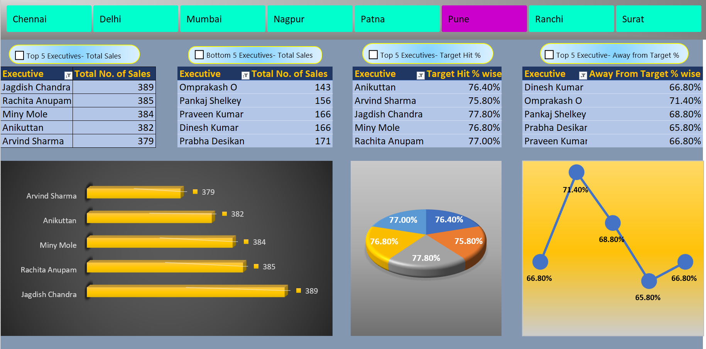

# Excel Sales Performance Dashboard

## Project Overview
Developed an interactive Sales Performance Dashboard in Microsoft Excel to analyse executive-level sales performance, monitor target achievement, and identify performance gaps across multiple locations.
---
## Project Objectives
- Analyse total sales by executive.
- Identify the top 5 and bottom 5 sales executives.
- Compare target achievement percentages.
- Identify executives who are away from their sales targets.
- Enable location-wise analysis through interactive slicers.
---
## Tools and Technologies
- Microsoft Excel
- PivotTables and PivotCharts
- Interactive Slicers
- VBA and Macros
- Data Analysis and Visualization
---
## Key Features
1. **Top 5 Executives:** Ranks executives by total sales.
2. **Bottom 5 Executives:** Identifies executives with lower sales.
3. **Target Hit Analysis:** Compares target achievement percentages.
4. **Away from Target Analysis:** Highlights performance gaps.
5. **Location Filters:** Enables analysis for Chennai, Delhi, Mumbai, Nagpur, Patna, Pune, Ranchi, and Surat.
6. **Dashboard Navigation:** Uses VBA macros to simplify navigation between dashboard views.
7. **Interactive Visualizations:** Includes bar, pie, and line charts.
---
## Business Value
The dashboard transforms sales data into an interactive reporting tool that helps users monitor performance, compare executives, identify target gaps, and conduct location-wise analysis efficiently.
---
## Skills Demonstrated
Data Analysis | Excel Dashboard Development | PivotTables | PivotCharts | Slicers | VBA Automation | Data Visualization | Interactive Reporting
---
## Project Files
- `Sales_Performance_Dashboard.xlsx` - Excel dashboard file.
- 
---
## How to Use
1. Download the Excel dashboard.
2. Open it in Microsoft Excel.
3. Enable macros only if you trust the file and VBA functionality is required.
4. Select a location to filter the dashboard.
5. Explore the sales, target achievement, and performance charts.
---
## Author
Rumana Yasmin
---
